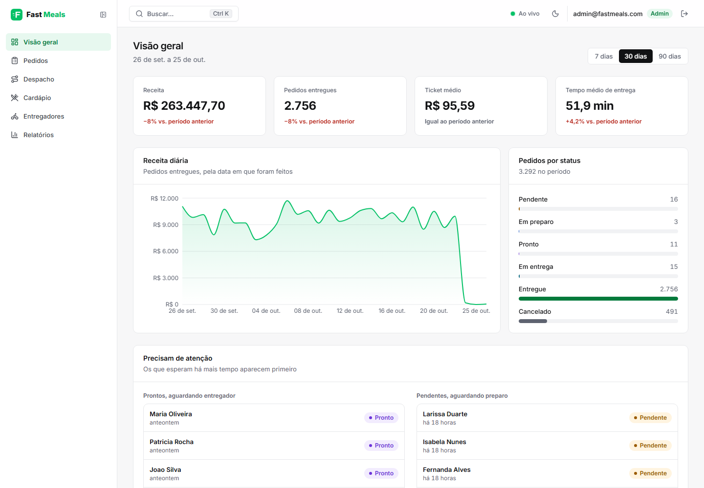
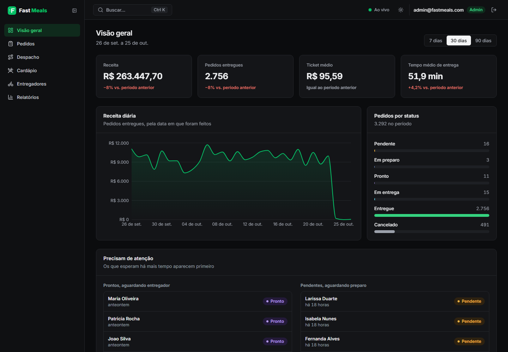
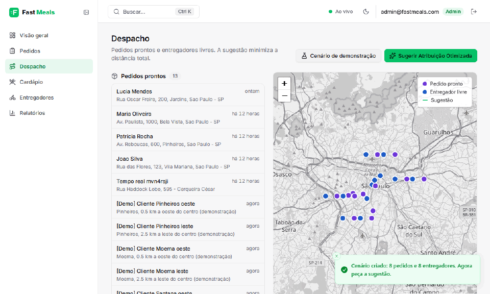
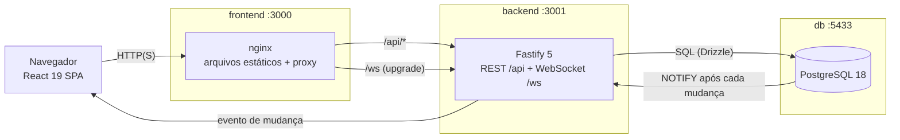
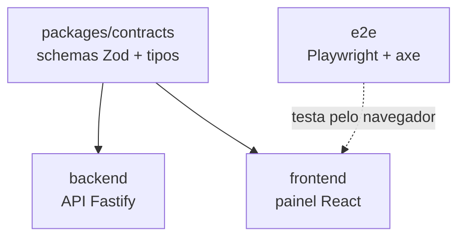
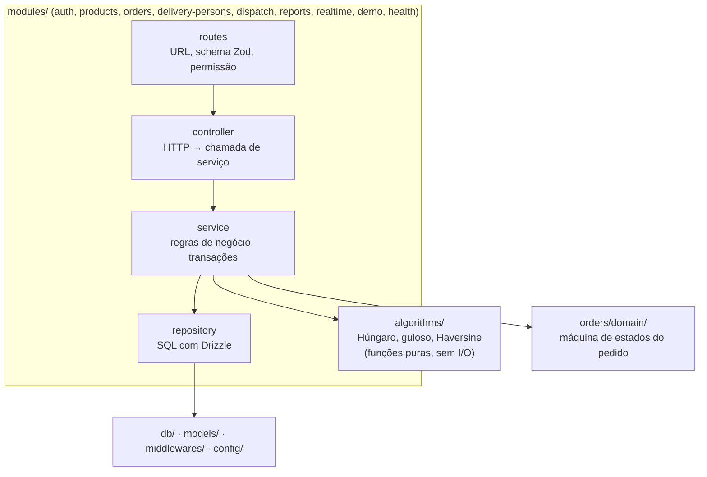
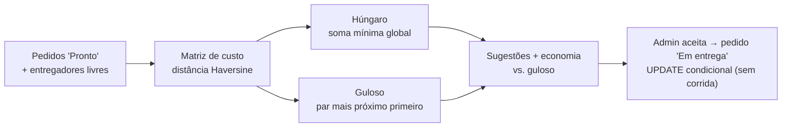
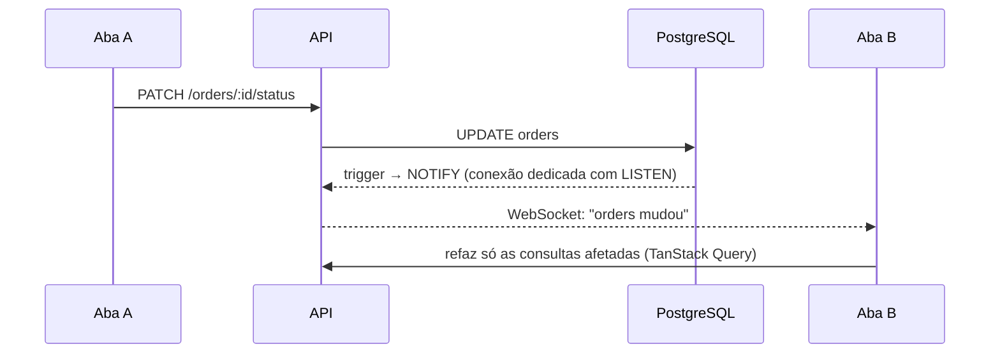
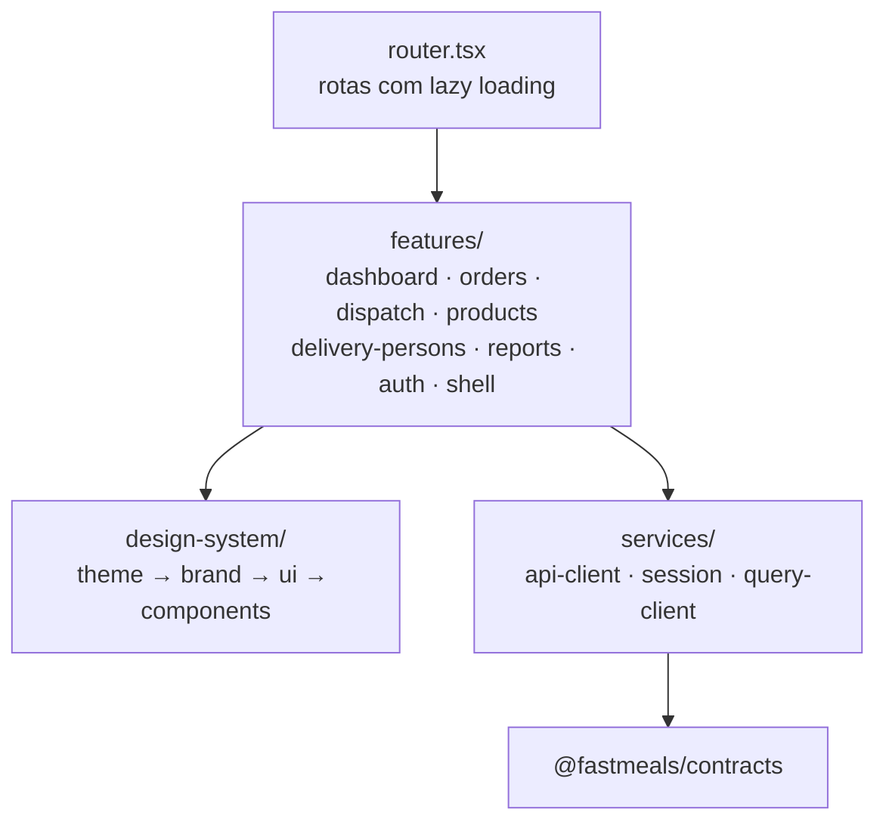

# FastMeals

[](https://github.com/renatomf/fast-meals/actions/workflows/ci.yml)

Painel administrativo de uma plataforma de delivery: cardápio, pedidos, entregadores, relatórios e **atribuição otimizada de entregas** (algoritmo Húngaro). Solução do [desafio técnico](docs/challenge.md) para Engenheiro de Software Sênior.

**Demo online:** https://fastmeals.onrender.com (botão "Entrar como admin"). Fica no plano gratuito do Render: depois de um tempo sem uso, o primeiro acesso leva cerca de um minuto para acordar.

## Como rodar

Só precisa do **Docker** (com Compose). Na raiz do projeto:

```bash
docker compose up --build
```

Pronto. Banco, migrations e dados de exemplo sobem sozinhos. Abra **http://localhost:3000** e clique em **"Entrar como admin"**.

| Perfil              | Email                  | Senha        |
| ------------------- | ---------------------- | ------------ |
| Admin (tudo)        | `admin@fastmeals.com`  | `Admin@123`  |
| Viewer (só leitura) | `viewer@fastmeals.com` | `Viewer@123` |

| O quê                  | Onde                           |
| ---------------------- | ------------------------------ |
| Painel                 | http://localhost:3000          |
| API                    | http://localhost:3001/api      |
| Documentação (Swagger) | http://localhost:3001/api/docs |
| PostgreSQL             | `localhost:5433`               |

> `docker-compose up --build` (o comando do enunciado) também funciona. O banco usa a porta 5433 para não colidir com um PostgreSQL local.

## Visão geral

| Tema claro                                                    | Tema escuro                                                   |
| ------------------------------------------------------------- | ------------------------------------------------------------- |
|  |  |



## Avalie em 5 minutos

1. **Algoritmo:** em **Despacho**, clique em "Cenário de demonstração" e depois em "Sugerir Atribuição Otimizada". O card compara o Húngaro com o guloso (cada pedido para o entregador mais próximo), o mapa mostra as rotas e "Ver matriz de distâncias" mostra por que o ótimo às vezes ignora o par mais próximo. Aceite uma sugestão: o pedido vai para "Em entrega".
2. **O resto:** pedidos com filtros e ações por status, cardápio, entregadores e relatórios. `Ctrl+K` abre a busca; o tema escuro fica no cabeçalho.
3. **Permissões:** entre como viewer. Tudo aparece, mas as ações ficam desabilitadas com o motivo.
4. **Tempo real:** abra duas abas e mude um pedido em uma; a outra atualiza sozinha.

Opcional:

- **Volume para os relatórios:** `docker compose exec backend node src/db/seed-load.ts` cria 10 mil pedidos encerrados nos últimos 90 dias.
- **Restaurante funcionando sozinho:** `npm install && npm run simulate` na raiz cria e avança pedidos pela API; as telas abertas atualizam ao vivo.

| Para avaliar | Comece por                                                                                                                                                                                                                |
| ------------ | ------------------------------------------------------------------------------------------------------------------------------------------------------------------------------------------------------------------------- |
| Algoritmo    | [`hungarian.ts`](backend/src/algorithms/hungarian.ts), [`haversine.ts`](backend/src/algorithms/haversine.ts), [ADR 0002](docs/adr/0002-hungarian-assignment.md), [`assignment.test.ts`](backend/tests/assignment.test.ts) |
| Requisitos   | [`requirements-traceability.md`](docs/requirements-traceability.md): onde cada requisito está e como é testado                                                                                                            |
| Decisões     | [`DECISIONS.md`](DECISIONS.md) e os [ADRs](docs/adr/)                                                                                                                                                                     |
| Desempenho   | [`benchmarks.md`](docs/benchmarks.md)                                                                                                                                                                                     |

## Arquitetura

### Visão do sistema

Três containers. O navegador fala só com o nginx do front, que serve a SPA e encaminha `/api` e `/ws` para a API. Front e API ficam na mesma origem, então o cookie do refresh token funciona com `SameSite=Strict` e não há CORS.



### Monorepo

Um repositório, quatro pacotes npm. Os contratos (schemas Zod) são a única coisa compartilhada: o mesmo schema valida o formulário no front e a requisição na API, e gera os tipos dos dois lados.



```
backend/             API Fastify (Node 24 executa o TypeScript direto, sem build)
frontend/            Painel React + Vite + Tailwind 4 + shadcn/ui
packages/contracts/  Schemas Zod e tipos compartilhados entre front e back
e2e/                 Testes Playwright e de acessibilidade (axe)
docker/postgres/     Imagem endurecida do PostgreSQL
docs/                Enunciado, especificação, ADRs e rastreabilidade
seed/data.json       Dados oficiais do desafio
```

### Backend: monólito modular

Cada domínio é um módulo isolado com as mesmas quatro camadas. As setas só apontam para baixo, e o ESLint (`eslint-plugin-boundaries`) reprova o build se alguém pular uma camada ou importar o interior de outro módulo.



| Pasta                       | Responsabilidade                                                                                    |
| --------------------------- | --------------------------------------------------------------------------------------------------- |
| `src/modules/*`             | Um domínio por pasta: `*.routes.ts`, `*.controller.ts`, `*.service.ts`, `*.repository.ts`           |
| `src/algorithms/`           | Atribuição ótima: Húngaro O(n²·m), guloso como referência e distância Haversine                     |
| `src/modules/orders/domain` | Transições válidas de status (`pending → preparing → ready → delivering → delivered`, cancelamento) |
| `src/models/`               | Tabelas do Drizzle                                                                                  |
| `src/db/`                   | Pool, migrations e seeds                                                                            |
| `src/middlewares/`          | Autenticação, autorização e tratamento de erros                                                     |
| `src/config/`               | Variáveis de ambiente validadas com Zod na subida                                                   |

### O algoritmo de despacho



- **Húngaro com potenciais**, O(n²·m). Com mais pedidos que entregadores, a matriz é transposta; os pedidos que sobram ficam para a próxima rodada.
- **Testado contra força bruta**: property tests com fast-check em matrizes de até 7×6, com 500 casos.
- **Teste de mutação** (Stryker): 91% das mutações detectadas.
- 500×500 resolve bem abaixo de 2 s. Decisão completa na [ADR 0002](docs/adr/0002-hungarian-assignment.md).

### Tempo real



O aviso vem do próprio banco, então qualquer escrita gera evento: a API, o seed ou um `psql` manual. Se o WebSocket cair, o front volta a consultar a cada 30 s. Detalhes na [ADR 0005](docs/adr/0005-real-time-updates.md).

### Frontend



- **Features** são independentes e expõem só o `index.ts`; uma feature não importa o interior de outra.
- **Design system em camadas**: tokens de tema (claro/escuro), marca, primitivos (shadcn/ui) e componentes compostos.
- **Estado do servidor** com TanStack Query; formulários com React Hook Form e o mesmo schema Zod da API.
- **Sessão**: o access token fica só em memória e o refresh token num cookie `httpOnly`; a renovação é única mesmo com várias requisições simultâneas.
- **Responsivo e acessível**: testado a 360 px e com axe (WCAG 2.1 AA) no E2E.

### Banco de dados

PostgreSQL 18 com a integridade garantida no próprio banco, não só no código:

- **Um entregador, um pedido em entrega**: índice único parcial. Duas atribuições simultâneas não passam.
- **Status sem corrida**: `UPDATE ... WHERE status = <esperado>`; quem chega depois recebe 409.
- **Exclusão lógica** de produtos e entregadores, para não quebrar o histórico de pedidos.
- IDs `uuidv7`, triggers de `updated_at` e de `NOTIFY`.

Mais em [ADR 0003](docs/adr/0003-database-integrity-and-concurrency.md) e [`database-schema.md`](docs/database-schema.md).

### Segurança

JWT de curta duração com refresh token rotativo (reuso detectado revoga a família), rate limit no login e na API, `helmet`, CSP no nginx, permissões verificadas antes da validação do corpo e imagem do PostgreSQL endurecida. Detalhes em [ADR 0004](docs/adr/0004-token-storage-and-rotation.md) e [`DECISIONS.md`](DECISIONS.md).

## Testes e qualidade

```bash
npm run lint         # inclui as regras de fronteira entre camadas
npm run typecheck
npm test             # backend com PostgreSQL real: docker compose up -d db
npm run build
npm run test:e2e     # Playwright contra o Docker (veja abaixo)
npm run test:mutation --workspace backend   # Stryker no algoritmo e na máquina de estados
```

O E2E passa do limite de 100 requisições por minuto da API. Suba o ambiente com um limite maior antes (os limites de login não mudam), e na primeira vez instale o navegador com `npx playwright install chromium` dentro de `e2e/`:

```bash
RATE_LIMIT_MAX=1000 docker compose up --build -d          # bash
$env:RATE_LIMIT_MAX=1000; docker compose up --build -d     # PowerShell
```

O CI roda tudo isso, audita dependências e imagens Docker e sobe a stack completa para o E2E.

## Rodando sem Docker

<details>
<summary>Node.js 24 e um PostgreSQL próprio</summary>

Requer Node.js 24.22.1 ou superior na linha 24 (veja `.nvmrc`) e um PostgreSQL acessível.

```bash
cp .env.example .env   # ajuste DATABASE_URL (ou use o banco do Docker: docker compose up -d db)

# Terminal 1
cd backend
npm install
npm run seed           # migrations + dados de seed/data.json
npm run dev            # http://localhost:3001

# Terminal 2
cd frontend
npm install
npm run dev            # http://localhost:3000
```

O "Cenário de demonstração" do despacho precisa de `DEMO_MODE=true` no `.env` (no Docker já vem ligado). Os 10 mil pedidos para os relatórios saem com `npm run seed:load` em `backend/`. Mais em [`backend/README.md`](backend/README.md) e [`frontend/README.md`](frontend/README.md).

</details>

## Deploy (Render + Neon)

<details>
<summary>Passo a passo</summary>

A demo em https://fastmeals.onrender.com roda exatamente assim. O [`render.yaml`](render.yaml) descreve a mesma arquitetura do compose: a API e o front (nginx) como dois serviços Docker, com o banco no [Neon](https://neon.tech) (PostgreSQL 18).

1. **Neon:** crie um projeto com PostgreSQL 18 e copie a connection string **direta** (host sem `-pooler`), trocando o final por `?sslmode=verify-full`. O tempo real usa `LISTEN`, que não funciona atrás do pooler.
2. **Render:** New → Blueprint → este repositório. O Render cria os dois serviços e gera os segredos JWT.
3. **Variáveis fora do repositório**, no painel do Render:
   - `fastmeals-api` → `DATABASE_URL` (a do passo 1) e `CORS_ORIGIN` (URL do front);
   - `fastmeals` → `API_UPSTREAM` (URL da API).
4. **Volume para os relatórios (opcional):** `npm run seed:load` em `backend/` com o `DATABASE_URL` do Neon.
5. **Demo sempre atual:** no GitHub, em Settings → Secrets and variables → Actions, crie o segredo `DEMO_DATABASE_URL` com a mesma connection string. O workflow [`demo-refresh.yml`](.github/workflows/demo-refresh.yml) roda todo dia às 3h e traz o histórico de pedidos para perto de hoje; sem ele, os gráficos ganhariam um dia vazio no fim a cada dia.

A API aplica as migrations e o seed ao subir. No plano gratuito, os serviços dormem sem uso e o primeiro acesso leva cerca de um minuto.

</details>

## Documentação

- [`DECISIONS.md`](DECISIONS.md): escolhas técnicas, premissas, segurança e dificuldades
- [`docs/adr/`](docs/adr/): registros de decisões de arquitetura
- [`docs/requirements-traceability.md`](docs/requirements-traceability.md): onde cada requisito está atendido e testado
